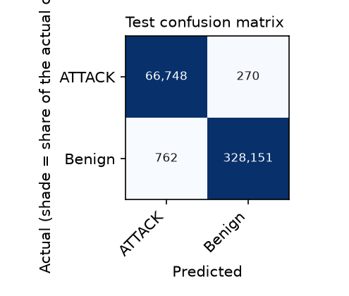

# Evaluation report

- Model: `rf-580816bcd7`  |  trained 2026-10-25T07:15:56+00:00
- Dataset: CIC-IDS2017 (Kaggle dhoogla, cleaned parquet) (Kaggle V3, downloaded 2026-10-25), licence: CC BY-NC-SA 4.0 (Kaggle dhoogla/cicids2017; original data: Canadian Institute for Cybersecurity), source: https://www.kaggle.com/datasets/dhoogla/cicids2017
- Task: binary  |  split: stratified  |  seed: 42
- Rows train/val/test: 1266977 / 316745 / 395931

## Cleaning

| Step | Rows |
|---|---|
| rows_raw | 2313810 |
| dropped_missing_or_non_finite | 0 |
| dropped_below_min | 88 |
| dropped_non_integer | 0 |
| dropped_unknown_category | 1589 |
| dropped_duplicates | 332480 |
| rows_clean | 1979653 |
| dropped_rare_classes | none |

## Held-out TEST: attack vs benign (CIC-IDS2017 (Kaggle dhoogla, cleaned parquet), stratified split)

| Precision | Recall | F1 | FPR | FPR 95% CI | Benign flows | False positives |
|---|---|---|---|---|---|---|
| 98.87% | 99.60% | 99.23% | 0.23% | 0.22% - 0.25% | 328913 | 762 |

At this FPR the model would raise about 232 false alarms per 100,000 benign flows.

## Per-class (TEST)

| Class | Precision | Recall | F1 | Support |
|---|---|---|---|---|
| ATTACK | 98.87% | 99.60% | 99.23% | 67018 |
| Benign | 99.92% | 99.77% | 99.84% | 328913 |

Macro F1 (test): 99.54%  |  Macro F1 (validation): 99.50%

## Leakage checks

- Identical feature rows in both train and test: 316
- Best single-feature balanced accuracy on validation (depth-3 tree), flag if > 0.95:
  - total_bwd_bytes: 0.919
  - bwd_pkt_len_mean: 0.916
  - pkt_len_std: 0.898
  - total_bwd_packets: 0.861
  - total_fwd_bytes: 0.847

## Top feature importances (impurity-based, unreliable for correlated features)

- num__bwd_pkt_len_mean: 0.185
- num__pkt_len_std: 0.172
- num__total_bwd_bytes: 0.138
- num__total_fwd_bytes: 0.069
- num__fwd_pkt_len_mean: 0.065
- num__total_bwd_packets: 0.060
- num__total_fwd_packets: 0.056
- num__flow_iat_max: 0.038

## Operational meaning

- False positive: a legitimate source gets blocked. Cost is lost availability and a locked-out user.
- False negative: an attack passes unnoticed. Cost is the damage the attack was meant to do.
- Blocking thresholds, whitelists and TTLs belong to the policy engine (Laptop 3), not this model.

## Caveats

- Stratified row-level split: flows from the same session or attacker can land on both sides, so scores are optimistic. Prefer --split group or time when the CSV has IP or timestamp columns.
- Hyperparameters are fixed defaults; no tuning was done against the test set.
- Random Forest probabilities are not calibrated.
