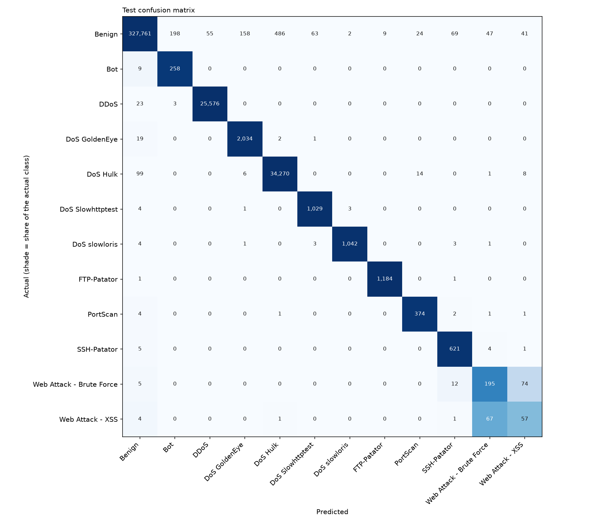

# Evaluation report

- Model: `rf-d64f3a43de`  |  trained 2026-10-25T07:21:50+00:00
- Dataset: CIC-IDS2017 (Kaggle dhoogla, cleaned parquet) (Kaggle V3, downloaded 2026-10-25), licence: CC BY-NC-SA 4.0 (Kaggle dhoogla/cicids2017; original data: Canadian Institute for Cybersecurity), source: https://www.kaggle.com/datasets/dhoogla/cicids2017
- Task: multiclass  |  split: stratified  |  seed: 42
- Rows train/val/test: 1267014 / 316754 / 395943

## Cleaning

| Step | Rows |
|---|---|
| rows_raw | 2313810 |
| dropped_missing_or_non_finite | 0 |
| dropped_below_min | 88 |
| dropped_non_integer | 0 |
| dropped_unknown_category | 1589 |
| dropped_duplicates | 332355 |
| rows_clean | 1979711 |
| dropped_rare_classes | {'Infiltration': 36, 'Web Attack - Sql Injection': 20, 'Heartbleed': 11} |

## Held-out TEST: attack vs benign (CIC-IDS2017 (Kaggle dhoogla, cleaned parquet), stratified split)

| Precision | Recall | F1 | FPR | FPR 95% CI | Benign flows | False positives |
|---|---|---|---|---|---|---|
| 98.31% | 99.74% | 99.02% | 0.35% | 0.33% - 0.37% | 328913 | 1152 |

At this FPR the model would raise about 350 false alarms per 100,000 benign flows.

## Per-class (TEST)

| Class | Precision | Recall | F1 | Support |
|---|---|---|---|---|
| Benign | 99.95% | 99.65% | 99.80% | 328913 |
| Bot | 56.21% | 96.63% | 71.07% | 267 |
| DDoS | 99.79% | 99.90% | 99.84% | 25602 |
| DoS GoldenEye | 92.45% | 98.93% | 95.58% | 2056 |
| DoS Hulk | 98.59% | 99.63% | 99.11% | 34398 |
| DoS Slowhttptest | 93.89% | 99.23% | 96.48% | 1037 |
| DoS slowloris | 99.52% | 98.86% | 99.19% | 1054 |
| FTP-Patator | 99.25% | 99.83% | 99.54% | 1186 |
| PortScan | 90.78% | 97.65% | 94.09% | 383 |
| SSH-Patator | 87.59% | 98.42% | 92.69% | 631 |
| Web Attack - Brute Force | 61.71% | 68.18% | 64.78% | 286 |
| Web Attack - XSS | 31.32% | 43.85% | 36.54% | 130 |

Macro F1 (test): 87.39%  |  Macro F1 (validation): 86.59%

## Leakage checks

- Identical feature rows in both train and test: 379
- Best single-feature balanced accuracy on validation (depth-3 tree), flag if > 0.95:
  - flow_iat_mean: 0.529
  - flow_pkts_per_s: 0.515
  - flow_iat_max: 0.479
  - flow_duration_us: 0.470
  - total_bwd_bytes: 0.458

## Top feature importances (impurity-based, unreliable for correlated features)

- num__total_bwd_packets: 0.096
- num__flow_iat_std: 0.086
- num__flow_iat_max: 0.080
- num__flow_duration_us: 0.079
- num__flow_iat_mean: 0.077
- num__total_bwd_bytes: 0.074
- num__flow_pkts_per_s: 0.070
- num__pkt_len_std: 0.069

## Operational meaning

- False positive: a legitimate source gets blocked. Cost is lost availability and a locked-out user.
- False negative: an attack passes unnoticed. Cost is the damage the attack was meant to do.
- Blocking thresholds, whitelists and TTLs belong to the policy engine (Laptop 3), not this model.

## Caveats

- Stratified row-level split: flows from the same session or attacker can land on both sides, so scores are optimistic. Prefer --split group or time when the CSV has IP or timestamp columns.
- Hyperparameters are fixed defaults; no tuning was done against the test set.
- Random Forest probabilities are not calibrated.
