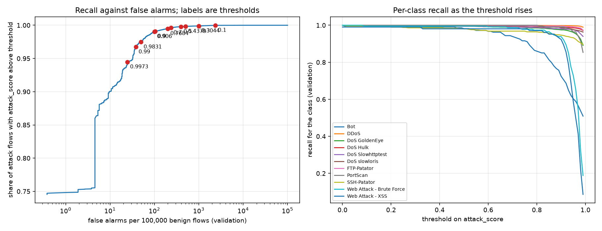

# Threshold analysis, model rf-d64f3a43de

attack_score = 1 - P(Benign). An alert fires when attack_score is above the threshold.
Thresholds were chosen on the validation split (316754 flows). The test split (395943 flows) is confirmation only.
Precision and false-alarms-per-real-attack columns assume attacks are 1% or 0.1% of flows, not the dataset's mix.

## Validation

| rule | threshold | attack_recall | alarms_per_100k_benign | precision_1pct_attacks | false_alarms_per_real_attack_0.1pct |
|---|---|---|---|---|---|
| argmax rule |  | 99.77% | 333.68 | 75.13% | 3.34 |
| score > 0.1 | 0.1000 | 99.98% | 2363.47 | 29.94% | 23.62 |
| score > 0.3 | 0.3000 | 99.90% | 1006.73 | 50.06% | 10.07 |
| score > 0.5 | 0.5000 | 99.79% | 396.76 | 71.76% | 3.97 |
| score > 0.7 | 0.7000 | 99.63% | 236.01 | 81.00% | 2.37 |
| score > 0.9 | 0.9000 | 99.08% | 103.37 | 90.64% | 1.04 |
| score > 0.99 | 0.9900 | 96.73% | 38.38 | 96.22% | 0.40 |
| <= 25 alarms/100k (val) | 0.9973 | 94.48% | 24.70 | 97.48% | 0.26 |
| <= 50 alarms/100k (val) | 0.9831 | 97.47% | 49.79 | 95.19% | 0.51 |
| <= 100 alarms/100k (val) | 0.9060 | 99.05% | 99.95 | 90.92% | 1.01 |
| <= 200 alarms/100k (val) | 0.7684 | 99.49% | 199.90 | 83.41% | 2.01 |
| <= 500 alarms/100k (val) | 0.4379 | 99.82% | 499.37 | 66.88% | 5.00 |
| <= 1000 alarms/100k (val) | 0.3044 | 99.90% | 999.89 | 50.23% | 10.00 |

## Test confirmation, same thresholds

| rule | threshold | attack_recall | alarms_per_100k_benign | precision_1pct_attacks | false_alarms_per_real_attack_0.1pct |
|---|---|---|---|---|---|
| argmax rule |  | 99.74% | 350.24 | 74.20% | 3.51 |
| score > 0.1 | 0.1000 | 99.97% | 2396.07 | 29.65% | 23.94 |
| score > 0.3 | 0.3000 | 99.89% | 1049.21 | 49.02% | 10.49 |
| score > 0.5 | 0.5000 | 99.77% | 416.52 | 70.76% | 4.17 |
| score > 0.7 | 0.7000 | 99.61% | 241.40 | 80.65% | 2.42 |
| score > 0.9 | 0.9000 | 99.08% | 113.10 | 89.85% | 1.14 |
| score > 0.99 | 0.9900 | 96.67% | 44.39 | 95.65% | 0.46 |
| <= 25 alarms/100k (val) | 0.9973 | 94.50% | 28.88 | 97.06% | 0.31 |
| <= 50 alarms/100k (val) | 0.9831 | 97.58% | 55.94 | 94.63% | 0.57 |
| <= 100 alarms/100k (val) | 0.9060 | 99.05% | 111.58 | 89.97% | 1.13 |
| <= 200 alarms/100k (val) | 0.7684 | 99.49% | 205.22 | 83.04% | 2.06 |
| <= 500 alarms/100k (val) | 0.4379 | 99.82% | 522.93 | 65.85% | 5.23 |
| <= 1000 alarms/100k (val) | 0.3044 | 99.88% | 1042.83 | 49.17% | 10.43 |

## Per-class share of flows flagged as attack (validation)

| class | argmax rule | score > 0.1 | score > 0.3 | score > 0.5 | score > 0.7 | score > 0.9 | score > 0.99 | <= 25 alarms/100k (val) | <= 50 alarms/100k (val) | <= 100 alarms/100k (val) | <= 200 alarms/100k (val) | <= 500 alarms/100k (val) | <= 1000 alarms/100k (val) |
|---|---|---|---|---|---|---|---|---|---|---|---|---|---|
| Bot | 98.13% | 99.53% | 99.07% | 98.13% | 93.93% | 72.43% | 50.93% | 50.93% | 53.74% | 72.43% | 89.25% | 99.07% | 99.07% |
| DDoS | 99.93% | 99.98% | 99.98% | 99.94% | 99.90% | 99.79% | 98.97% | 97.44% | 99.35% | 99.78% | 99.89% | 99.95% | 99.98% |
| DoS GoldenEye | 99.45% | 100.00% | 99.57% | 99.45% | 98.97% | 97.51% | 89.12% | 87.11% | 92.46% | 97.51% | 98.60% | 99.45% | 99.57% |
| DoS Hulk | 99.74% | 100.00% | 99.91% | 99.77% | 99.59% | 99.04% | 97.18% | 94.17% | 97.78% | 98.98% | 99.42% | 99.80% | 99.90% |
| DoS Slowhttptest | 99.40% | 100.00% | 99.64% | 99.40% | 99.04% | 98.07% | 93.98% | 93.61% | 95.30% | 98.07% | 98.80% | 99.52% | 99.64% |
| DoS slowloris | 99.53% | 99.76% | 99.64% | 99.53% | 99.53% | 98.58% | 96.32% | 96.09% | 96.80% | 98.58% | 99.41% | 99.53% | 99.64% |
| FTP-Patator | 99.79% | 100.00% | 100.00% | 99.79% | 99.79% | 99.47% | 97.37% | 97.37% | 98.52% | 99.47% | 99.58% | 99.79% | 100.00% |
| PortScan | 100.00% | 100.00% | 100.00% | 100.00% | 100.00% | 99.02% | 85.34% | 80.13% | 91.21% | 99.02% | 100.00% | 100.00% | 100.00% |
| SSH-Patator | 97.82% | 99.60% | 98.61% | 98.02% | 96.83% | 94.64% | 89.68% | 88.49% | 90.48% | 94.44% | 96.43% | 98.41% | 98.61% |
| Web Attack - Brute Force | 99.56% | 99.56% | 99.56% | 99.56% | 98.68% | 93.86% | 18.86% | 17.11% | 32.02% | 93.86% | 97.81% | 99.56% | 99.56% |
| Web Attack - XSS | 98.08% | 99.04% | 99.04% | 98.08% | 98.08% | 92.31% | 8.65% | 6.73% | 22.12% | 92.31% | 98.08% | 98.08% | 99.04% |

